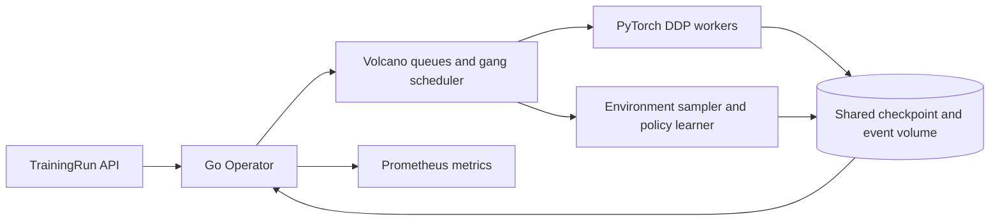

# GRAFT

**GPU Resource-Aware Fault-tolerant Training**

GRAFT orchestrates GPU training through Kubernetes, schedules complete worker groups
with Volcano, and restores interrupted training from transactional checkpoints.
A Go Operator manages the job lifecycle. PyTorch workers implement distributed
language-model training and reinforcement learning environment interaction.

## Capabilities

- **Declarative orchestration:** a `TrainingRun` custom resource describes the workload,
  resource requirements, priority, checkpoint interval, and recovery budget.
- **Resource-aware scheduling:** Volcano handles gang admission, GPU queue capacity,
  and the priority order of waiting jobs.
- **Coordinated recovery:** GRAFT observes worker failures and training progress,
  stops the previous worker group, and starts a new attempt with a distinct identity.
- **Transactional checkpoints:** each rank writes model, optimizer, RNG, and data
  progress; a checksummed manifest commits the generation after every rank finishes.
- **Controller continuity:** Kubernetes Lease election and persistent run status allow
  a replacement controller to continue supervising an active job.
- **Workload extensibility:** Transformer DDP and policy-gradient environment jobs
  share the same Kubernetes lifecycle and artifact interface.
- **Reproducible experiments:** automated scenarios verify recovery state, scheduling,
  concurrent submission handling, environment retries, and batch/memory tradeoffs.

## Recorded results

The dual-V100 run records the following results:

| Capability | Result |
|---|---|
| Coordinated recovery | Model and optimizer tensors match uninterrupted training exactly on both ranks |
| Controller continuity | Leader replacement in 16.36 seconds with the original training attempt preserved |
| Concurrent submission | 100 held jobs through 16 clients; P95 client create latency 0.371 seconds |
| Scheduling | Waiting-job priority ordering and whole-group GPU admission verified |
| Training configuration | Median throughput from 101,645 to 282,086 tokens/s at fixed global batch 64: 2.78x |
| Environment interaction | 240 unique episodes, 30 policy updates, and successful timeout retry |

[Read the experiment report](results/dual-v100/REPORT.md) for the configurations,
measurement definitions, per-rank state comparisons, and repeated measurements.

## Architecture



The Operator owns logical attempts and recovery decisions. Volcano owns admission,
placement, and child Pod management. PyTorch owns distributed communication and
gradient synchronization. Recovery begins after the previous group's Kubernetes
resources have been removed, with artifact paths separated by run UID and attempt.

## Quick start

The reference deployment uses Linux, two CUDA GPUs, Go 1.23, Docker, Kubernetes,
NVIDIA Container Toolkit, and PyTorch 2.5.0/CUDA 12.4. The supplied platform script
installs K3s 1.32.11, Volcano 1.11.1, and NVIDIA device plugin 0.17.0 on a dedicated
GPU host with an installed NVIDIA driver.

```bash
git clone https://github.com/zhenyu818/GRAFT.git
cd GRAFT

# Run platform installation as root on the GPU host.
sudo bash scripts/bootstrap.sh

# Use a Python environment containing torch==2.5.0.
make test
make images
sudo make load
sudo make install

kubectl apply -f config/examples/language-model.yaml
kubectl -n graft-system get trainingruns -w
```

To build the worker from an existing PyTorch 2.5.0 environment, run
`bash scripts/build-runtime-image.sh "$CONDA_PREFIX"` after `make build`, build the
controller with `docker build -f build/controller.Dockerfile -t graft-controller:0.1.0 .`,
then use the same `make load` and `make install` steps. The recorded deployment uses
this environment-reuse build with Python 3.12 and NumPy 2.1.3.

Each training worker requests one GPU. The reference artifact volume is a retained
20 GiB local persistent volume at `/var/lib/graft/artifacts`. Both training Pods and
the Operator mount it at `/artifacts`, with UID/GID 10001.

## Run the experiments

```bash
make experiment
make report
```

The suite runs uninterrupted training, process exit recovery, stalled-worker
recovery, checkpoint write interruption, worker Pod replacement, controller leader
replacement, waiting-job priorities, gang admission, concurrent held submissions,
reinforcement learning, and repeated microbatch/accumulation comparisons.

Results are stored under `results/dual-v100/`. The report is generated directly from
the JSON records by `scripts/report.py`.

## Repository layout

```text
api/v1alpha1/         TrainingRun API and lifecycle status
cmd/manager/         Operator entry point
internal/controller/ Reconciliation, worker-group construction, and controller tests
python/graft_worker/ DDP training, RL sampling, and checkpoint protocol
config/              CRD, RBAC, storage, priorities, queue, deployment, and examples
build/               Controller and worker container definitions
scripts/             Platform setup, experiment execution, reporting, and verification
tests/               Checkpoint integrity and environment protocol tests
results/             Recorded experiments and generated reports
docs/                Design and experiment methodology
```

## Documentation

- [System design](docs/DESIGN.md)
- [Experiment methodology](docs/EXPERIMENTS.md)
- [Reproducibility and file integrity](docs/REPRODUCIBILITY.md)
- [Recorded results](results/dual-v100/REPORT.md)

## Development

```bash
gofmt -w api cmd internal
go vet ./...
go test -race ./...
PYTHONPATH=python python3 -m unittest discover -s tests -v
```

Controller metrics include `graft_recoveries_total`, controller-runtime reconcile
metrics, and workqueue metrics. Inspect them through the `graft-metrics` ClusterIP
Service or a Kubernetes port-forward.

## References

- [Kubernetes Operator pattern](https://kubernetes.io/docs/concepts/extend-kubernetes/operator/)
- [Volcano scheduler](https://volcano.sh/docs/scheduler/overview/)
- [PyTorch distributed training](https://pytorch.org/docs/stable/distributed.html)
- [PyTorch elastic launch](https://pytorch.org/docs/stable/elastic/run.html)

## License

[MIT](LICENSE)
