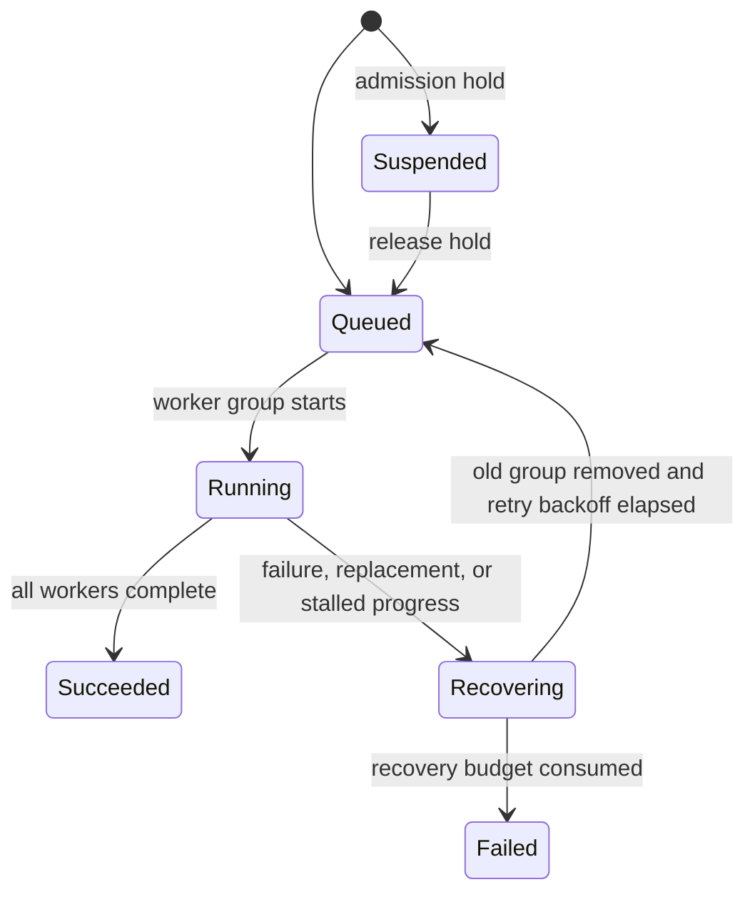

# System Design

## Control and execution responsibilities

`TrainingRun` is the durable declaration of one logical execution. Its status stores
the observed generation, phase, active attempt, worker identities, progress, and
recovery history. A namespaced Lease elects one active Operator from two replicas.
Reconcile workers process independent resources concurrently.

The Operator creates a ConfigMap, a headless rendezvous Service, and a Volcano Job
with deterministic names. Owner references connect their lifecycle to the run.
Repeated events converge on the same objects. Configuration resources are created
before the worker group, so Pods can consume their inputs at startup.

Volcano enforces the job's `minAvailable`, GPU queue capability, and priority class.
The GRAFT queue has a two-GPU capacity. Priority classes order waiting jobs and use
`preemptionPolicy: Never`. This makes the priority experiment measure queue order
while the active training job completes normally.

## Recovery state machine

Each attempt has a unique child Job name and artifact directory. A worker failure,
worker identity change, or progress timeout triggers whole-group recovery. GRAFT
first removes child jobs and Pods, waits for their disappearance, and then advances
the attempt number. Queue waiting uses admission state; progress timeout starts
when the worker group runs. Startup and steady-state progress have separate timers.

The job's lower-level restart loops are disabled. `torchrun --max-restarts=0` and the
Volcano `AbortJob` failure policy leave the retry budget and attempt lifecycle with
the Operator. All ranks restore from a common committed generation at fixed world
size, preserving the configured global batch and training state.

## Checkpoint transaction

The POSIX shared-volume commit sequence is:

1. Each rank serializes model, optimizer, CPU RNG, CUDA RNG, and data cursor to a
   temporary file, flushes it, and replaces its rank file atomically.
2. A distributed barrier establishes that every rank file is complete.
3. Rank zero computes file SHA-256 values and publishes `manifest.json` by atomic
   replacement, followed by a directory fsync.
4. A second barrier makes the committed generation visible to the worker group.

Generations include both optimizer step and attempt. Restore scans manifests in
descending step order, checks configuration identity, world size, the complete
rank set, and every checksum, and broadcasts the selected generation to all ranks.
The same checkpoint protocol supports the single-coordinator RL workload.

## Progress and artifacts

Rank zero publishes `progress.json` after completed optimizer steps. The Operator
updates its progress timer only when the observed step advances. A live process
with a stationary step therefore reaches the same bounded recovery path as an
exited worker. Events carry wall-clock time, attempt, rank, and a typed event name.

Artifact paths separate attempts and retain checkpoint history across Kubernetes
resource deletion. `complete.json` and `result.json` commit a worker result. The
Operator marks success after the result exists and the worker group completes.

## Reinforcement learning adapter

An environment exposes reset and asynchronous step operations. The policy samples
bounded-concurrency episodes while its version remains fixed. Completed episodes
carry unique IDs and the sampled policy version. The learner checks these fields,
computes discounted returns, and performs one REINFORCE update per collection
round. A step timeout discards that episode attempt and retries under the same ID;
the accepted trajectory is consumed once.

## Resource and framework tuning

The language-model worker accumulates gradients using `DDP.no_sync()` on intermediate
microbatches. The final microbatch synchronizes gradients before one optimizer
update. Global batch is `microbatch × accumulation × world size`. The experiments
hold it constant and vary the first two factors, measuring throughput and allocated
CUDA memory under the same token workload.

## Access and deployment

The controller ServiceAccount has a namespaced Role for TrainingRuns, child Jobs,
Pods, ConfigMaps, Services, and leader-election Leases. Controller and training
containers use UID/GID 10001. The controller has a read-only root filesystem;
artifacts use the explicitly mounted persistent volume. Metrics are exposed through
a ClusterIP Service.
